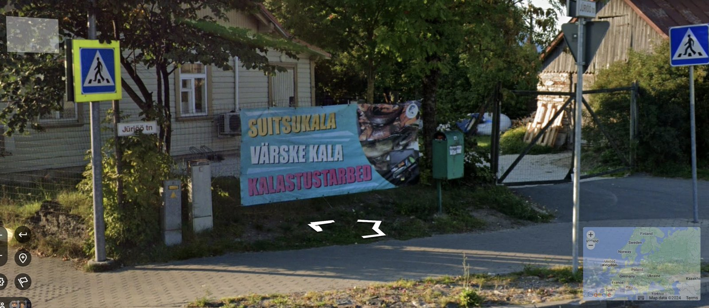
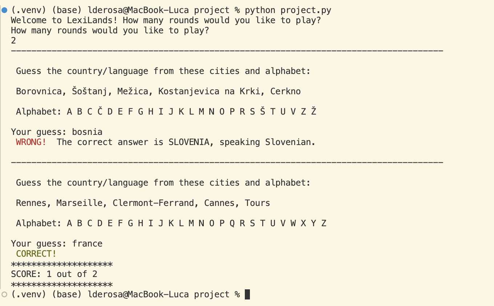

# LexiLands
A quiz to learn to recognise European languages from place names. My final project for Harvard's [CS50P](https://cs50.harvard.edu/python/) (Introduction to Programming with Python), January 2025.

- **Author:** Luca De Rosa ([L5900](https://github.com/L5900))
- **Video demo:** https://youtu.be/9FBCpp701-U
## Description: 
 This project provides a learning tool to improve recognition of languages from text. 

This project implements a quiz that trains you to recognize languages (or countries) from text written in local languages. The idea arose from playing competitive [*Geoguessr*](https://www.geoguessr.com), which is a world-famous geolocation game. Here is an example of a [Geoguessr match](https://youtu.be/M7rKQcoEnOw?si=VjpuoRp3wYPEm4lK).

 In a typical game of Geoguessr players see a random location in Google Street View, and attempt to guess the location (see picture below). Points are awarded based on the proximity of the guess. Recognising languages from text in street signs, advertisements and shop displays is a crucial skill in competitive Geoguessr. Beyond that, this project helps you build a solid understanding of the typical patterns, similarities and differences of written languages, which is a valuable skill in general.
 

 

 ## Files:
 The files included in the project are:
 - **project.py**: Contains the `main()` and all the other functions;
 - **test_project.py**: Tests performed using pytest library;
 - **requirements.txt**: List of requirements needed to run the program. In our case it consists solely of the library `pytest`;
 - **README.md**: Documentation and description of the project (this file);
 - **dataset.json**: Dataset containing the data of all the countries involved in the game.


## Gameplay:
 The program runs as follows:
 1. A welcome message is displayed. You are asked how many rounds would you like to play.
 2. You are shown 5 names of cities in a random country in the European continent. You are asked to input your guess. 
 3. You will see if your answer is correct or wrong. If it is wrong, the correct answer will be displayed. Then you'll be prompted with a new round.
 4. When all the rounds have been played, the program shows your score and exits.

 Here is a gameplay example:


 


## How to run

Requires Python 3.10 or newer.

```bash
python project.py        # 5 city hints per round
python project.py 8      # choose the number of hints (up to 30)
```

To run the tests: `pip install -r requirements.txt`, then `pytest`.

## Features
The main features of the program are:
1. **Interactive Gameplay** and **Dynamic Sampling:** Each round presents a set of cities and the full alphabet of the language. Since the cities are sampled from a dataset of 45 to 75 cities for each country, the user is essentially never shown the same cities repeatedly. For example, if "Italian" is randomly chosen, the cities could be "Rome, Caltanisetta, Caserta, Trento, Viareggio" in one round and "Salerno, Perugia, Teramo, Lecce, Palermo" in another one. This ensures long lasting gameplay experience. Moreover, the user can specify with an inline argument the number of city hints. The default value is 5. Finally the scoring system provides a measure of improvement over time.
2. **Robust Input Validation:** The program ensures valid inputs with a good degree of flexibility. For example, if in a round I see "Rome, Caltanisetta, Caserta, Trento, Viareggio", all the following answers would be considered accepted: `"italian", "Italy", "italy", " italy", "italy ", "ItAlY ", " iTaLiaN "`.
3. **Scalability:** The project was implemented keeping an eye on features addition in the future. In this regard, we divided the functions performing procedural tasks from the ones containing logic. For example, check_rounds() contains the logic of a round, while play_round() contains the procedure of printing a hint and asking for an input. This modularity simplifies the process of adding new features in the future.

## Design and Challenges

### Core functions:
The functions defined in `project.py` are as follows:
1. `main()` contains the logical skeleton of the program.
2. `get_sample()` returns the number of cities we are shown at each round. The default value is 5, but can be modified via inline commands using `sys` library.
3. `get_rounds()` returns an integer representing the number of rounds the user chose to play. This function uses regular expressions to validate the input, and is iterated until a valid input is given.
4. `load_dataset(file_path)` loads the `JSON` dataset using `with open ... as` construct.
5. `check_round(entry, guess)` encapsulates the logic of each round. Precisely, it checks if the guess matches the `"language"` or `"country"` key value of the entry in `dataset.json`. The parameters `entry` and `guess` are defined in `play_round()`.
6. `play_round(dataset)` handles the actions of a round. It selects a random entry from the dataset, prompts the user for their guess, and passes the variables `entry` and `guess` to `check_round`, returning 1 or 0 depending on the correctness of the answer.


A major challenge I encountered in this project was **deciding which information to display as hints**. The initial idea was to use randomly generated sentences, and use an external Google Translate API to translate them. The issue with this approach is that european languages often overlap significantly. For example "I love you" in Swedish is translated as "Jag älskar dig", which is also the correct translation in Norwegian. How could we accurately distinguish a correct answer from a  wrong one? I realised it was impossible (given my limited experience) to control all possible overlap of translations of randomly generated words. Hence I decided to write a dataset myself, with words that would be unique and representative to each country. This approach turned out to be too naive as well. In doing so, we would have a very small set of words for each country, and the game wouldn't be anymore about recognising languages, but would reduce to simply learn by heart a small set of words. Essentially, there is a **tradeoff between the diversity and quality of hints**. The more variation I wanted (e.g. by generating random sentences, and then translating), the less control I had on the quality of this data. On the other hand, if I would force the quality of the data by writing it myself, then such data would be very scarce and the game wouldn't be fun. The solution I found was using a special class of words for each countries: names of cities! This solves the ambiguity of overlaps of languages, and makes the game not only about languages, but also about geography. The user gets a correct score both by recognising typical linguistic patterns, or by recognising a certain city name. I noticed however that the game was still very difficult, and was rare to get a score higher than 2 out of 10, hence I decided to include the alphabets among the hints. This provides additional information about special characters of the language.

Therefore, a typical entry in `dataset.json` looks like this:


```json
{
  "language": ["Lithuanian"],
  "country": ["Lithuania"],
  "city": [
    "Vilnius", "Kaunas", "Klaipėda", "Šiauliai", "Panevėžys",
    "Alytus", "Marijampolė", "Mažeikiai", "Jonava", "Utena",
    "Kėdainiai", "Telšiai", "Tauragė", "Ukmergė", "Plungė",
    "Biržai", "Radviliškis", "Visaginas", "Druskininkai", "Elektrėnai",
    "Šilutė", "Šakiai", "Kupiškis", "Varėna", "Raseiniai",
    "Trakai", "Ignalina", "Pakruojis", "Jurbarkas", "Kelmė",
    "Zarasai", "Molėtai", "Širvintos", "Anyksčiai", "Kaišiadorys",
    "Švenčionys", "Prienai", "Pasvalys", "Kalvarija", "Akmenė",
    "Rokiškis", "Palanga", "Kretinga", "Birštonas", "Neringa",
    "Lazdijai", "Veisiejai", "Vilkyškiai", "Šilalė", "Žagarė",
    "Skuodas", "Salantai", "Grigiškės", "Ežerėlis", "Veiviržėnai",
    "Gargždai", "Dūkštas", "Pagėgiai", "Rumšiškės", "Varniai",
    "Gelgaudiškis", "Linkuva", "Kalvarija", "Darbėnai", "Kaltinėnai",
    "Žiežmariai", "Kavarskas", "Viekšniai", "Juodkrantė", "Šeduva"
  ],
  "alphabet": "A Ą B C Č D E Ę Ė F G H I Į J K L M N O P R S Š T U Ų Ū V Z Ž"
}
```


 The countries included in the game are: Albania, Armenia, Austria, Azerbaijan, Belarus, Bulgaria, Croatia, Cyprus, Czechia, Denmark, Estonia, Finland, France, Georgia, Germany, Hungary, Iceland, Ireland, Italy, Latvia, Liechtenstein, Lithuania, Luxembourg, Malta, Moldova, Montenegro, North Macedonia, Norway, Poland, Portugal, Romania, Russia, Serbia, Slovakia, Slovenia, Spain, Sweden, Switzerland, Turkey, Ukraine, United Kingdom. Most countries of the European Union are included (Belgium, Greece and the Netherlands are still missing), plus other countries of the European continent which are not part of the EU (e.g. Switzerland, Turkey, Ukraine, Russia). The decision to focus on the European continent comes from its peculiar difficulty in Geoguessr. This is due to the huge language diversity concentrated in such a small geographical region. 
 
 In order to manage the complex relationship between "language" and "country" I decided to allow multiple entries. In other words, both the values associated with the keys "language" and "country" are both lists of strings.
 For example, assume the random entry is "Montenegro". We want to consider correct both the answer "bosnian" and "croatian", as they are both widely spoken, officially recognised, and can be easily seen in the streets.

 I decided to use **JSON format for its flexibility**. In this way it will be easier to manipulate the data, and add new features. For example, we could add a new key `"region"` with values "Balkans", "Baltics", "Mediterranean" etc. and add the possibility for users to play only with countries in a specified region.

 Another challenge was given by **testing the code** in `test_project.py`. Since the function `get_rounds()` requires a keyboard input from the user, I didn't know how to obtain that in `pytest`. Hence I had to get accustomed with the `monkeypatch` fixture of pytest, which allows to simulate user inputs. On the other hand, the function `check_rounds()` takes a dataset as input. In this case I tested it by defining a mock dataset in `test_project.py`, and then use `assert`.


 ## Further potential improvements
 When making this program I tried to see it as a first version of a very improvable and modular project, and I tried to write my code accordingly. Some obvious improvements would be, first of all, implementing a **graphical interface** to make the quiz actually look like a proper game. Another obvious improvement would be **expanding the dataset** with all the remaining countries of the world. In particular, the South-East Asia, and India are regions with an incredibly rich variety of spoken and written languages, and it would be very interesting to include them in the dataset.


